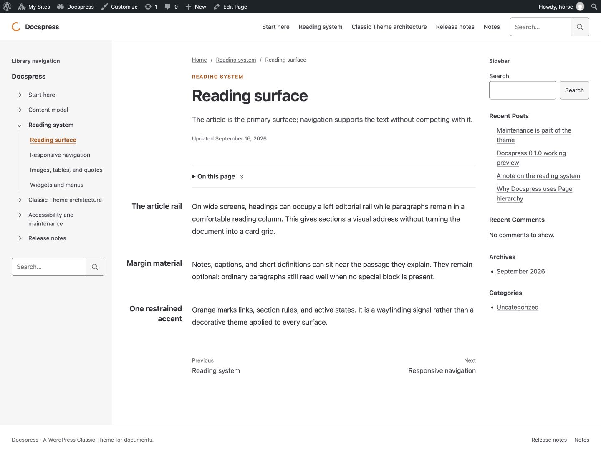
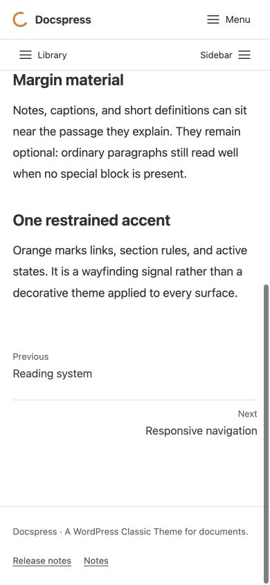

# Docspress 成熟度升级：最终验收与部署

验收日期：2026-10-23 至 2026-10-24（Asia/Tokyo）。最终源码、安装包与生产：**0.9.1**。

## 交付结论与边界

本轮目标已实施到自托管演示站 [wordpress.im/docspress](https://wordpress.im/docspress/)。0.9.0 完成主要升级，0.9.1 补齐无标题导航、原生摘要过滤及语言缓存边界。当前仍称 maturity candidate，不擅自晋升 1.0，不代表 WordPress.org 审核通过。

- 使用现有 Classic Theme 模板、Customizer、menus、widgets、原生内容与 enqueue；没有另造内容系统或依赖插件。
- 只更新 Docspress 主题文件与命名子站的演示内容；未调整兄弟站设置、DNS、邮件、账户权限或其他主题。
- 没有本轮 Git commit、push、tag、GitHub Release 或 WordPress.org 提交。工作树保留未提交的实现、测试和文档，历史用户修改未清理。
- 用户明确要求“跳过这个验收，你用技术验收或者模拟验收即可”：实机 iPhone/Android 不再是本轮放行条件。未将桌面模拟写成真机结果。

## 1. 实现落点

所有模板共用 `header.php → leftbar → main → rightbar → footer.php`，仅一个 main。左栏背景限定在 shell，footer 是 shell 之后的兄弟元素。默认双栏，只有显式设置可以关闭。

四种导航独立：Header Primary Menu；Leftbar 的 Page tree/附加原生菜单/左 widgets；Rightbar 的原生 sidebar-1 widgets；文章内 details TOC。每个面板只有一份 DOM，不复制 widgets，不把文章目录放进右栏。

原生配置：保留 sidebar-1，新增 Left Sidebar Widgets、Footer Widgets；Primary / Left Sidebar / Footer 三个菜单位置；阅读宽度、字号、TOC 深度、修改时间显示和左右栏开关。空配置仍有搜索、站点信息、Feed 和近期内容等 fallback。

阅读系统：680px 标准正文，600px compact，17px 标准字体；手机 1.8 行高。只有 main 实际容器足够宽时启用 136px editorial rail + 24px 间距；中小屏回归单列。标题、正文段落、TOC 对齐，宽表格/代码局部滚动。

资料库：一次按 parent 分组和稳定排序；请求内缓存按站点、root、语言区分；保留显式 Unicode 锚点，处理全内容 ID 冲突；公开树、密码保护与内容过滤；原生 breadcrumb、搜索上下文、前后篇及可信的修改时间。无标题条目仍有可识别的链接和按钮名称。

## 2. 十四项硬验收

下表是本轮技术/浏览器验收，不是人类辅助技术认证。原任务书的逐项标准保留不变，设备验收按用户明确指示替换。

| 项 | 判定及实测 | 权威证据 |
| --- | --- | --- |
| 1 左/右宽度 | PASS：390px 下 273px=70%；343.195px≈88%，低于90%；border-box 包含 padding | production-0.9.1-drawers.json；CSS contract |
| 2 全页双栏/独立菜单/篇内 TOC | PASS：15种生产路由×2宽度=30例；每页 main/left/right 各1；侧栏及 article 外 TOC 均0；Menu 不打开左右栏 | production-0.9.1-route-matrix.json；production-0.9.1-independent-navigation.json |
| 3 抽屉键盘/隔离/命中 | PASS：左右 role=dialog、aria-modal；close 命中；Shift+Tab 留在面板；Escape 返回原按钮；正文具有 inert 祖先；背景滚动锁 | production-0.9.1-drawers.json；production-0.9.1-independent-navigation.json；短高度/跨断点测试记录 |
| 4 toolbar 开关/滚走 | PASS：生产管理员 My Sites；46px/32px 实际核心 toolbar；手机部分滚走 offset 20.5px，完全滚走归0；普通 subscriber 开关 toolbar 时 header y=32/0 | toolbar-partial-scroll.json；subscriber-toolbar.json；production-0.9.1-anchor.json |
| 5 同一顶部栈/锚点 | PASS：手机最终锚点 top301.797px，高于 controls bottom102px，无遮挡；header top0 随已滚走的 toolbar 归0 | production-0.9.1-anchor.json；local-geometry.json |
| 6 横向溢出与局部滚动 | PASS：本地320–1920及断点边界、三语言长文、生产30例全局 overflow=0；表格/pre 仅溢出时补键盘入口和说明 | local-geometry.json；local-routes-320.json；生产矩阵；navigation.js |
| 7 主轴与 footer | PASS：1440和390下 H1 与首段 x偏差0；footerTop=shellBottom，footer 不在 shell 内。宽屏 prose wrapper 包含160px rail，不能把 wrapper 左边界误作正文起点 | production-axes.json；footer-boundary-1440.jpg；最终宽屏截图；结构源码 |
| 8 对比度与触屏 controls | PASS：ink/faint/accent 对白/浅灰最低4.65:1；主要按钮/手机 tree controls 为44px；焦点 outline 保留。装饰 brand 色不当作文本 | css-contract-0.9.1.json；最终抽屉命中测试 |
| 9 图像/旁注/手机关系 | PASS：中日英长文含自然比例图、caption、quote、table、code；手机浮动/配对内容线性化；widgets 留在抽屉，不复制到文末 | 三语言截图；local-routes-320.json；main.css |
| 10 原生 widgets/设置/编辑器 | PASS：三个区域、classic/block widgets、空右栏 fallback、sidebar-1 实例保留；Classic Editor 更新往返；Firefox 原生 Block Editor 输入三语言段落、保存草稿并重载 | runtime-assertions.php；final-0.9.1-checks.json；configuration-assertions.json；编辑器截图 |
| 11 heading/权限 | PASS：真实 WP HTML API 测试含中文日文、显式/重复/冲突ID、nested markup、空/隐藏 heading；密码/私有标记不泄漏；原生 excerpt filter 被尊重 | tests/test-docspress.php；minimum-runtime-0.9.1.json；HTTP smoke；configuration-assertions.json |
| 12 JS失败/断点/返回 | PASS：缺少 navigation 资源时320px仍可导航，侧栏和菜单在正常文流；高度变化保留抽屉，宽度变化关闭并解锁；返回后无残留inert、面板或滚动锁 | navigation-asset-failure-320.jpg；local geometry；production-0.9.1-history.json |
| 13 工程/最低版本 | PASS：PHP7.4.33+WP6.5.13真实运行；WP7.1.3+PHP8.2.29隔离站；WPCS/PHPCompatibility 0错误0警告；Theme Check无REQUIRED/ERROR/WARNING；生产前端console无warning/error | minimum-runtime-0.9.1.json；final-0.9.1-checks.json；theme-check-0.9.1.json；production-0.9.1-console.json |
| 14 安装/升级/回退/一致性 | PASS：隔离站精确ZIP安装；0.9.1→0.9.0→0.9.1后内容/slug/parent/widgets/theme mods哈希不变；主题切换保持内容；生产全部44文件一致 | rollback-0.9.1.json；runtime tests；两个production-0.9.1哈希清单 |

## 3. 测试环境与覆盖深度

- 主隔离站：`/tmp/docspress-upgrade.ejzAkA`，WP7.1.3、PHP8.2.29、SQLite。最终运行的是精确 ZIP 安装副本，不是指向项目源码的 symlink；目录 diff 为0。
- 最低版本：官方 Playground CLI 3.1.60，PHP7.4.33 / WP6.5.13，原生主题激活和 HTML API/helper assertions 通过。不是以 PHP8.x 静态扫描冒充最低版本运行。
- 生产：path-based Multisite，WP7.1.3；真实管理员 toolbar 和 My Sites；未使用生产凭据脚本或导出会话。
- 本地 CSS 宽度记录包含320/360/390/430/640/768/1024/1280/1440/1920；另覆盖599/600/601、639/640/641、767/768/769、781/782/783、980/981、1023/1024/1025、1280/1281、1439/1440/1441。以 JSON 内实际 width 为准，不以请求尺寸/文件名冒充。
- 生产最终矩阵：静态首页、章节、两种资料正文、三篇新增文档、普通Post、Notes、普通Page、分类/作者/日期归档、搜索有/无结果、404；1440及390各15例。匿名HTTP单独15例，期望状态均通过。
- 本地22条匿名HTTP包括密码保护和 Theme Unit Test 数据的标题、分页、评论、宽内容、归档等核心 surfaces；不是只测首页200。
- 原生 Safari/WebKit：匿名宽屏阅读、TOC跳转、footer边界实际渲染；Firefox/Gecko：双向抽屉、Escape焦点返回、200%及400%宽窗口缩放重排、Block Editor；Chromium/IAB：主要登录态矩阵与精确几何/键盘测试。各引擎不是机械运行全部组合。
- RTL：实际切换核心 Arabic locale，验证方向、面板和命中后恢复LTR；不把 rtl.css 文件存在当作完成。
- 1000个真实原生Page：第一次树查询1次、重复读取0次；渲染120个节点，保留当前深层路径；59,053字节，当前QA一次query/tree/render18.2ms。此数值不是生产TTFB或完整页面性能承诺。
- Customizer边界：合法选项生效、非法选项回退；edit_theme_options；无root/已删root；无标题导航；0/1条TOC不显示；最新文章首页；原生child PHP/CSS覆盖。测试变更均恢复，临时内容移入隔离站Trash。

Theme Check剩余4个 RECOMMENDED 是 custom block patterns/styles、custom-header/background；不是错误/警告，也没有为消除建议加入不需要的产品功能。唯一 INFO 是 text-domain=docspress。

## 4. 视觉留证





同目录还保留 Safari、Firefox、三语言、RTL、无JS、短屏、footer、widgets/Customizer及原生编辑器截图。早期 `block-editor.jpg` 的空白 iframe 是 IAB 表现，使用默认主题也可复现；已用 Firefox 的真实画布和保存/重载解决验证缺口，不再将空白截图作为通过证据。

旧文件 `production-upload-comparison.jpg` 捕获时界面已变为主题列表，不用于证明原比较页。最终升级以带版本号的 `production-0.9.1-upload-comparison.jpg`、`production-0.9.1-installed.jpg` 和源码哈希为准。

## 5. 精确安装包与生产一致性

最终：`build/docspress-0.9.1.zip`，44个文件，仅一个 `docspress/` 根目录，`unzip -t` 通过。

SHA-256：`74a7f4cb0da1024546e99b7f934d6fab93f87161416c1425aec756ca1258a967`。

通过 Network Admin 原生上传器，确认已装0.9.0/上传0.9.1后执行替换，界面返回 `Theme updated successfully.`。没有重新激活别的主题或改写子站配置。

- [41个可编辑文件](production-0.9.1-source-hashes.json)：原生 Theme File Editor 只读取得源码，逐文件SHA一致；没有使用 Update File。
- [10个公开资源](production-0.9.1-public-assets.json)：含上述部分文件及剩余 LICENSE/POT/PNG，逐字节SHA一致。
- 两个清单的并集覆盖全部44个主题文件；不是仅凭版本header/HTTP200断言完整部署。

## 6. 自我展示内容

来源始终在独立 `site-content/`，不打进主题ZIP。31项manifest=27Pages+4Posts。保留生产Sample Page和原widgets实例，不重跑全站导入。

| 操作 | 生产ID | 内容 |
| --- | --- | --- |
| 更新 | 1013 | Responsive navigation：真实断点、双抽屉、toolbar、篇内TOC |
| 更新 | 1010 | Headings and page TOC：显式稳定锚点与文章归属 |
| 新建 | 1042 | Widgets and menus；Reading system下 |
| 新建 | 1044 | Maintaining a reference library；Accessibility and maintenance下 |
| 新建/补充 | 1046 | 0.9.0 maturity upgrade，含0.9.1收尾说明；保留该URL |
| 更新 | 1028 | Maintenance is part of the theme：修正演示站根地址 |

全部通过原生编辑器保存/发布并验证前台路径；不强制改变既有发布日期、parent、slug或permalink。WXR供空站初始化，使用固定演示日期及fixture IDs，不是生产增量同步器。

## 7. 回退资料与操作边界

| 资料 | SHA-256 / 用途 |
| --- | --- |
| build/docspress-0.9.0.zip | 328216f898677927910064b4ee66de9208424eeb1c1281c41e5a6b25a7dc8175；本次收尾修订前主题 |
| build/docspress-0.2.4.zip | e69ba4673e7cda4dc62cd1a6d1dd41fd1552a947eeb9f4fd7d8aa3ca034b9112；整轮升级前已发布主题 |
| build/docspress-before-upgrade-2026-10-23.tar.gz | 709f478b60a2b557a563ab4523bbc3d3f1f473607ed47127da6fe40a54f24203；本地变更前源码/工作资料 |
| build/docspress-production-before-0.9.0-2026-10-23.xml | dfe969991af3d539c88dd72eba4687d87584d7b3a435dcd2ddd7e1d47fa6171a；原生Export内容快照，权限600，gitignored |

WXR **不是完整数据库、uploads、widgets或网络设置备份**，不能当作一键灾难恢复。本轮生产未迁移数据库结构、未重排widgets/菜单、未动媒体；文件回退与内容回退是两件事。

需要回退主题时，先复核上表ZIP哈希，在同一原生主题上传器上传0.9.0或0.2.4并确认替换，保持Docspress为当前主题；再检查原有URL、正文、widgets与toolbar。新文档仍是普通Pages，不要求删除。若还需要撤回文案，使用原生revisions/本地内容源和WXR逐项核对；不要把完整演示WXR重新导入生产。主机完整灾难恢复应另用受控的数据库+uploads备份流程。

已在隔离站完成0.2.4↔0.9.0基础回退及最终0.9.1→0.9.0→0.9.1精确包演练；后者内容、slug/parent、widgets和theme mods哈希完全一致。没有为了演练而把生产站降级。

## 8. 复核入口

```sh
bash scripts/check-theme.sh
bash scripts/check-content.sh
node tests/http-smoke.mjs
node tests/verify-public-assets.mjs
unzip -t build/docspress-0.9.1.zip
git diff --check
```

原生WP集成测试用隔离站的PHP8.2.29及WP-CLI执行 `tests/test-docspress.php`、`runtime-assertions.php`、`configuration-assertions.php`、`scale-runtime.php`。配置测试的child fixture位于隔离站 `wp-content/themes/docspress-qa-child/`，不在发布包中。WP CLI入口为 `/opt/homebrew/Cellar/wp-cli/2.12.0/bin/wp`，主题工具依赖只在隔离站vendor内。

```sh
/tmp/docspress-upgrade.ejzAkA/vendor/bin/phpcs --standard=WordPress --extensions=php --report=json theme
/tmp/docspress-upgrade.ejzAkA/vendor/bin/phpcs --standard=PHPCompatibility --runtime-set testVersion 7.4- --extensions=php --report=json theme
```

最低环境的可复用blueprint：`tests/playground-minimum.json`。官方CLI的挂载语法为 `--mount-dir HOST VFS`（两个参数），不是把冒号路径传给此选项。测试服务器仅用于本地QA，交付时停止；保留隔离目录和证据，不自动删除用户资料。

## 9. 限制与后续独立决定

- 真机键盘、安全区、浏览器工具栏动态变化未实机测试，按用户指示以短高度/动态高度、安全区CSS和浏览器几何代替。不得称为真实iOS/Android通过。
- reduced-motion、forced-colors和print已有明确CSS规则并做技术审查；未声称完成每个OS设置/打印机/人类屏幕阅读器组合。无accessibility-ready标签或认证声明。
- 当前没有完整人类VoiceOver/NVDA审查。WordPress.org正式提交前仍要核验账号、署名、名称/slug及最新目录要求，并独立决定版本晋升；本轮不执行这些对外发布。
- 本轮生产主题上传初始列表曾显示核心 `wp-admin/theme-install.php` 的 `$paged` warning；发生在主题尚未运行的核心后台列表，非前台主题错误。未擅自修改WordPress核心。最终上传成功、前台日志及路由验收正常。
- 本地seed helper修复了深层路径匹配的幂等性。发现的测试重复Pages只移入隔离站Trash；生产未运行seed，未受此影响。

这些是明确的覆盖边界和后续独立审查事项，不将工程自测与目录批准、完整主机备份或人工辅助技术认证混为一谈。
